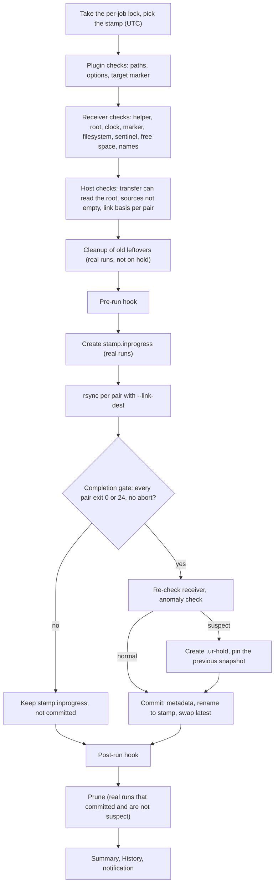

# Snapshot mode: user guide

Snapshot mode turns an SSH push job into a versioned backup: every run writes a
new dated copy on the receiver instead of updating one mirror. This guide
explains how to set it up, what a run does, and what to do when it stops.

All paths, hosts and ids below are examples (`/mnt/backup/…`,
`backup@backup.example`, job id `j-appdata`). Use your own.

Contents:

- [What snapshot mode is](#what-snapshot-mode-is)
- [Requirements](#requirements)
- [Layout on the receiver](#layout-on-the-receiver)
- [Setup, step by step](#setup-step-by-step)
- [How a run works](#how-a-run-works)
- [When a snapshot counts](#when-a-snapshot-counts)
- [Options](#options)
- [Retention](#retention)
- [Safety nets](#safety-nets)
- [Notifications and reasons](#notifications-and-reasons)
- [Hooks](#hooks)
- [Status and History](#status-and-history)
- [Restoring](#restoring)
- [Migrating an existing mirror](#migrating-an-existing-mirror)
- [Backing up the flash drive (/boot)](#backing-up-the-flash-drive-boot)
- [Security](#security)
- [Turning snapshot mode off](#turning-snapshot-mode-off)
- [Troubleshooting](#troubleshooting)

## What snapshot mode is

A job normally keeps **one mirror** on the destination. In **snapshot mode** it
keeps **dated, versioned copies** instead: every run writes a new directory on
the receiver, and files that did not change since the previous snapshot are
**hard links** to it (`rsync --link-dest`), so each snapshot costs only the space
of what changed while still being a complete tree you can browse and restore
from. A snapshot counts only once its run finished cleanly; old ones are
deleted by a retention policy.

|  | Mirror (default) | Snapshot mode |
| --- | --- | --- |
| The destination holds | one copy, updated in place | one complete directory per run, named by its UTC start time |
| History | none: yesterday's version of a file is gone once a run overwrites it | every kept snapshot is a full point-in-time tree |
| A file deleted or encrypted on the source | is deleted or overwritten on the destination by the next run (with `--delete`, or when the file is rewritten) | older snapshots keep the old version; a run that looks wrong puts deletions on hold |
| Space | the size of the source | the first snapshot is a full copy; each later one costs only the changed files |
| Transports | SSH, rsync daemon, Local; Push or Pull | SSH and Push only |
| Receiver | anything rsync can write to | GNU userland, root access, a target marker, a root you create |

## Requirements

- **SSH transport, Push direction.** rsync daemon, Local and Pull jobs cannot use
  snapshot mode. This is checked when you save and again at every run, because
  the connection can change after the job was saved.
- A receiver with **GNU coreutils and util-linux** (a normal Linux distribution;
  BusyBox, BSD and macOS receivers are not supported). Before every run the
  plugin self-tests what it needs on the receiver: `mkdir`, `mv -T`, symlink
  swap, `readlink -f`, `stat -c`, `df -Pk`, `sync -f`, `base64`, `sort`,
  `tail`, `nice`, `mktemp -d` and `rm --one-file-system`. `ionice` and
  `timedatectl` are used when present.
- **Root on the receiver**: either the connection logs in as `root`, or its user
  has **passwordless sudo for `sh`** (which is full root) and the connection has
  **Use sudo on the receiver** on. The transfer itself must also read the
  snapshot root as root: with a non-root login, point the job's **Remote rsync
  path** at a small sudo wrapper (see [step 3](#setup-step-by-step)).
  Why: the root is mode 0700, and rsync must keep owners and permissions.
- **rsync 3.2.4 or newer on both ends.** The plugin does not check the version.
- A **target marker** with expected content (a UUID) on the backup drive. In
  snapshot mode it is mandatory, and the snapshot root must be the marker's
  directory or lie inside it. Why: it ties the root to the drive, so a run never
  writes into an empty mountpoint.
- **Preserve times** (`-t`) on. Why: without modification times rsync never
  finds a file unchanged, so nothing is linked and every run is a full copy.

## Layout on the receiver

```
/mnt/backup/.unraid-rsync-target                 the target marker (holds a UUID)
/mnt/backup/snapshots/appdata/                   the job's snapshot root, 0700 root:root
/mnt/backup/snapshots/appdata/.ur-snapshot-root  sentinel: first line = the job id
/mnt/backup/snapshots/appdata/2026-10-20T030000Z/appdata/...   one snapshot, one dir per pair ("sub")
/mnt/backup/snapshots/appdata/2026-10-21T030000Z/appdata/...
/mnt/backup/snapshots/appdata/2026-10-22T030000Z.inprogress/  a run that did not commit (reused next run)
/mnt/backup/snapshots/appdata/latest -> 2026-10-21T030000Z     for humans; the plugin never reads it
/mnt/backup/snapshots/appdata/.ur-hold           deletions on hold (see below)
/mnt/backup/snapshots/appdata/<stamp>/.ur-keep   this snapshot is pinned, never pruned
```

Names are UTC stamps (`YYYY-MM-DDTHHMMSSZ`). Only a name that is exactly a stamp
is a complete snapshot. Besides pruning old snapshots, the plugin only deletes
its own leftovers: `<stamp>.inprogress` copies of runs that did not commit and
`.deleting` directories of an interrupted deletion. The newest unfinished copy
is kept as a link basis only while its stamp is newer than the newest complete
snapshot (or no snapshot is complete yet); every other one, including an
outdated newest one, is deleted by the next real run. Nothing else in the root is ever deleted.

Other names you may see:

- `<stamp>/.ur-snapshot.json`: the snapshot's metadata (file and byte counts per
  sub, free space before and after, whether it was suspect), mode 0600. The next
  run compares against it.
- `<stamp>.deleting/`: a snapshot being deleted. Deletion renames first and
  removes second, so an interrupted deletion never leaves a half-deleted
  directory under a valid snapshot name.
- `<stamp>.rolledback/`: left by the [rollback script](#migrating-an-existing-mirror).
  The plugin never touches it.

## Setup, step by step

The paths below are examples; use your own. The job id is in the first line of
every run log of the job (`Run started for job "Appdata" (j-appdata)`) and in
`/boot/config/plugins/unraid.rsync/config.json`.

1. **On the receiver, as root, create the target marker** (skip if the job
   already has one) and note its content:

   ```sh
   cat /proc/sys/kernel/random/uuid > /mnt/backup/.unraid-rsync-target
   cat /mnt/backup/.unraid-rsync-target
   ```

2. **Create the snapshot root (0700) and its sentinel** holding the job id. The
   plugin never creates either, so a missing drive can never be mistaken for an
   empty one:

   ```sh
   mkdir -p /mnt/backup/snapshots
   mkdir -m 0700 /mnt/backup/snapshots/appdata
   printf '%s\n' j-appdata > /mnt/backup/snapshots/appdata/.ur-snapshot-root
   ```

   The root must be on the same filesystem as the marker, and not on the
   receiver's system disk.

3. **Non-root login only.** Give the user passwordless sudo for `sh` and for
   rsync through a wrapper, then set the job's **Remote rsync path** to
   `/usr/local/bin/rsync-sudo` and tick **Use sudo on the receiver** on the
   connection (Connections tab):

   ```sh
   printf '%s\n' 'backup ALL=(root) NOPASSWD: /bin/sh, /usr/bin/rsync' > /root/unraid-rsync.sudoers
   visudo -cf /root/unraid-rsync.sudoers && install -m 0440 /root/unraid-rsync.sudoers /etc/sudoers.d/unraid-rsync
   printf '%s\n' '#!/bin/sh' 'exec sudo -n /usr/bin/rsync "$@"' > /usr/local/bin/rsync-sudo
   chmod 0755 /usr/local/bin/rsync-sudo
   ```

   Check the paths of `sh` and `rsync` on your receiver (`command -v sh rsync`).

4. **In the job** (Jobs tab): Transport **SSH**, Direction **Push**, the target
   marker path and its content, then turn **Snapshot mode** on and fill in the
   **snapshot root** and the retention. In each pair the right box becomes a
   **sub-directory name** (`appdata`, `docs`, ...). Tick **seed** on every pair
   for the first snapshot. Apply.

   The form fields and their defaults:

   | Field | Default | Allowed |
   | --- | --- | --- |
   | Snapshot root | empty (required) | absolute, normalised, at least two directories deep (three under `/mnt`), the marker's directory or inside it |
   | Keep snapshots: daily | 7 | 0–366 |
   | Keep snapshots: weekly | 4 | 0–260 |
   | Keep snapshots: monthly | 0 | 0–120 |
   | Max deletions per run | 3 | 1–20 |
   | Prune dry run | on | on / off |
   | Pair sub-directory name | empty (required) | 1–64 letters, digits, `_` or `-`, starting with a letter or digit; `latest` is reserved; unique within the job, ignoring case |
   | Pair seed | off | on / off |

   Daily + weekly + monthly must be at least 1.

5. **Dry-run, then Run.** A dry run checks everything on the receiver and lists
   what would be copied, and creates nothing. The first real run is a full copy;
   every later run links unchanged files to the previous snapshot. Once a pair
   is in a snapshot its **seed** flag has no effect (the log says so) and can be
   cleared. A pair added later needs **seed** for its first run.

6. **Pruning starts as a dry run.** With **Prune dry run** on (the default) every
   run logs its plan (`Prune plan: KEEP …` / `Prune plan: DELETE …`) and deletes
   no snapshot. Review those plans for a couple of weeks, then turn **Prune dry
   run** off and Apply. At most **Max deletions per run** snapshots are deleted
   per run; the rest wait for later runs. Prune dry run does not cover the
   cleanup of leftovers: unfinished `<stamp>.inprogress` copies (all but a
   newest one that is newer than the last committed snapshot) and `.deleting`
   directories are still removed by every real run (unless `.ur-hold` exists).

## How a run works

Every run of a snapshot job goes through these steps, in this order. Anything
that fails before the pre-run hook fails the run without starting your hook, so
a hook that stops containers never runs for a backup that cannot happen.



1. **Lock and stamp.** The run takes the job's lock (a second run of the same job
   is refused with `already-running`), then takes its stamp from this server's
   clock in UTC. The log says `Snapshot mode: this run's snapshot is <stamp> (UTC).`
2. **Plugin-side checks**, for every pair before anything is copied: the path
   guardrails, the snapshot settings (transport, root, marker, retention, sub
   names) and the [options](#options). A refused option fails the run with
   `snapshot-preflight`, any other rule with `guardrail`. Then the target marker
   is fetched over SSH and compared; a missing or wrong marker fails with
   `dest-not-mounted`.
3. **Receiver checks** through the plugin's helper script, run as root on the
   receiver over the job's SSH connection:
   - the helper file is verified first (a regular file, starts with `#!/bin/sh`,
     at most 32 KiB, sha256 as shipped); a modified helper fails the run;
   - `probe`: running as root (uid 0), the tool self-test, the receiver's clock.
     The log notes whether NTP is synchronised and whether `ionice` exists. A
     clock more than 120 s away from this server's fails with `snapshot-clock`;
   - `check`: the root is a real directory and canonical (no symlink in the
     path), the marker is a regular file whose first line is the expected
     content, the marker and the root are on the same filesystem and **not** on
     the filesystem of `/`, and the sentinel's first line is the job id;
   - `list`: the root's entries, `latest`, `.ur-hold`, the previous snapshot's
     subs and metadata, and free space. The receiver needs at least 5 % of the
     filesystem or 10 GiB free, whichever is larger;
   - the new stamp must sort after every stamp-shaped name in the root, or the
     run fails with `snapshot-clock`.
4. **Host checks.** The transfer's own SSH login (with the job's Remote rsync
   path) must be able to list the root. Every pair's source must exist, be a
   directory and not be empty. Every pair needs a **link basis**,
   `<previous snapshot>/<sub>`, or its **seed** flag. The log ends this part with
   `Snapshot root checked: previous snapshot <stamp>`, plus
   `unfinished <stamp>.inprogress reused as a link-dest` when the newest
   unfinished copy is newer than the newest complete snapshot (or none is
   complete yet).
5. **Cleanup** (real runs only, skipped while `.ur-hold` exists): leftover
   `.deleting` directories and every unfinished `.inprogress` copy are deleted,
   except the newest one when step 4 kept it as a link basis. An unfinished copy
   older than the last commit is deleted too. A failed deletion does not fail
   the run; it sets `prune-failed`.
6. **Pre-run hook**, if the job has one.
7. **`<stamp>.inprogress` is created** (real runs only). Failure:
   `snapshot-mkstamp-failed`.
8. **rsync, one pair at a time**, into `<root>/<stamp>.inprogress/<sub>/`, with
   `--info=stats2`, `--link-dest=<root>/<previous>/<sub>` when the pair has a
   basis, and `--link-dest=<root>/<newest unfinished>.inprogress/<sub>` when an
   unfinished copy was kept. The `Quiet` log level runs as `Summary`, because the
   statistics feed the anomaly check. After each pair the log shows
   `Pair #1 (appdata): <files> regular files, <size> bytes.`
9. **Completion gate**: see [When a snapshot counts](#when-a-snapshot-counts).
10. **Commit**, when the gate passes: the receiver is checked again, the
    [anomaly check](#suspect-runs) runs, an Abort is honoured one last time, and
    then the helper writes `.ur-snapshot.json`, flushes it to disk, renames
    `<stamp>.inprogress` to `<stamp>`, points `latest` at it and flushes again.
    The log says `Committed snapshot <stamp>. The filesystem grew by <n> KB.`
11. **Post-run hook**, if the job has one. It always runs, also after a failure.
12. **Prune**: see [Retention](#retention). It runs after the post-run hook, so
    services the hooks stopped are already back.
13. **Summary, History and the notification.**

**On a dry run** steps 1–4 run in full, so a dry run is a real test of the
receiver. Nothing is created or deleted: no cleanup, no `.inprogress`, no
commit, no prune. rsync runs with `-n` against the same link bases and lists
what a real run would copy (a dry run's log level is never quieter than
`Normal`). The hooks run too, with `UR_DRY_RUN=1`. When a previous snapshot
exists, the log then shows
`Dry run: the prune plan for the current listing (nothing is deleted):` and the
plan. A dry run never counts as a run that did not commit.

## When a snapshot counts

A snapshot is committed only when the run was not a dry run, was not aborted,
every pair ran, and every pair's rsync exit code is 0 or 24.

| Worst pair exit | Run state | Committed | Reason |
| --- | --- | --- | --- |
| 0 | SUCCESS | yes | none |
| 24 (files vanished during the transfer) | WARNING | yes | none (a normal notification) |
| 23 (some files could not be transferred) | PARTIAL | no | `snapshot-not-committed` |
| 30, 35 (timeout) | TIMEOUT | no | `snapshot-not-committed` |
| 20, 143 (Abort) | ABORTED | no | none |
| anything else | FAILED | no | `snapshot-not-committed` |

Exit 25 (`--max-delete` cap) cannot happen: deletion is forced off.

**A run that does not commit** leaves `<stamp>.inprogress` on the receiver and
logs `Snapshot <stamp> was not committed; <stamp>.inprogress is kept for the next run.`
It is never committed later. While the newest unfinished copy is newer than
the newest complete snapshot (or no snapshot is complete yet), the next run uses
it as a second `--link-dest`, so files it already received are linked instead
of sent again. Every other unfinished copy is deleted by the next real run's
cleanup, and so is the newest one once a later run has committed: an
unfinished copy older than the last commit is never a link basis again. It is
not a snapshot and is never counted by retention.

**Abort** stops the run at the next safe point: between pairs, during a pair
(rsync is stopped), during a deletion, or just before the commit. An aborted run
never commits; its `.inprogress` is kept like any other. The post-run hook still
runs. A runner that dies (a crash, a reboot) leaves its `.inprogress` too; the
crash alert names it.

## Options

Snapshot mode checks the job's **effective** options: the job's own, or Global
Settings when the job uses the global config. A Global Settings change that
breaks a snapshot job is refused when you save it.

**Forced off for the run.** The stored setting is kept, a warning is shown when
you save, and each run logs `<option> is forced off in snapshot mode.`

| Option | Why |
| --- | --- |
| `--delete`, `--delete-excluded`, `--max-delete` | every snapshot starts as an empty directory, so there is nothing to delete; a wrong path would otherwise empty the root |
| `--mkpath` | the helper creates the stamp directory; a missing root must fail, not be created on the system disk |
| Preserve hard links (`-H`) | memory cost on large trees, and its interplay with `--link-dest` is not verified. Files that are hard-linked to each other on the source arrive as separate files |
| In-place (`--inplace`) | also refused (below); forcing it off is a second guard |

**Refused when you save** (and `snapshot-preflight` at run time):

| Option | Why |
| --- | --- |
| In-place (`--inplace`) | a hard link shares one file with older snapshots, so writing into it in place changes those snapshots too |
| `--checksum` | reads every file of the previous snapshot in full on every run |
| `--size-only`, `--ignore-existing`, `--update` | can keep stale content: a changed file can be linked to its old version |
| `--backup-dir` | every snapshot is a fresh directory, so there is nothing to back up |
| Preserve times (`-t`) **off** | without modification times no file is ever linked, so every run is a full copy |

`--append` is not offered by the plugin at all. Everything else (partial
transfers, temp dir, compression, bandwidth limit, filters, …) works as usual.

**Changed permissions or owners cost a copy.** rsync links a file to the
previous snapshot only when it is unchanged (same size and modification time)
**and** identical in every attribute the job preserves (permissions, owner,
group). A file whose
mode or owner changed is stored again in full, because changing the attributes
of a hard link would change them in every older snapshot too. A
`chmod -R` or `chown -R` over a large share therefore costs one full copy of
that share in the next snapshot.

## Retention

Prune decides which complete snapshots to keep from the snapshots that exist in
the root, never from the calendar:

- **daily N**: the newest snapshot of each of the newest N UTC days that have a
  snapshot;
- **weekly N**: the newest snapshot of each of the newest N ISO weeks (Monday to
  Sunday, UTC) that have one;
- **monthly N**: the newest snapshot of each of the newest N UTC months that have
  one.

A day, week or month without a snapshot does not use up the count. "Keep 7
daily" therefore means the last 7 days on which a snapshot was taken, not the
last 7 days on the calendar: after a 10-day outage nothing is lost just because
it is older than a week.

**Always kept**, whatever the counts say: the newest complete snapshot, the
target of `latest`, the snapshot this run just committed, and every pinned
snapshot (`.ur-keep`).

**The floor.** Prune never takes the number of complete snapshots below
daily + weekly + monthly (or the current number, if that is lower). When the
plan would go below it, the newest snapshots of the delete list are kept and
logged as `floor`.

**Rate limit and backlog.** At most **Max deletions per run** (default 3)
directories are deleted per run, oldest first; leftover `.deleting` directories
go first and count against the limit. The rest wait for later runs, which logs
`<n> deletion(s) carried over to later runs (maxPrunePerRun is <n>).` and sets
`prune-backlog` (a warning). A new job with many old snapshots, or a lowered
retention, therefore converges over a few runs.

**When prune runs.** Only after a real run that committed, was not aborted and
is not suspect. It works from a fresh listing taken after the commit. With
**Prune dry run** on it logs the plan and
`Prune dry run is on (pruneDryRun), so nothing was deleted.` While `.ur-hold`
exists it logs the plan and deletes nothing (`snapshot-held`).

**Worked example.** Retention daily 3, weekly 2, monthly 1, max deletions 3.
The root holds a pinned snapshot from 2026-09-30, one snapshot every day at
03:00 UTC from 2026-10-12 to 2026-10-21, and an extra manual run on 2026-10-20
at 15:00 UTC. The run of 2026-10-21 03:00 UTC commits and plans:

```
Prune plan: KEEP 2026-09-30T030000Z (pinned).
Prune plan: KEEP 2026-10-18T030000Z (weekly).
Prune plan: KEEP 2026-10-19T030000Z (daily).
Prune plan: KEEP 2026-10-20T030000Z (floor).
Prune plan: KEEP 2026-10-20T150000Z (daily).
Prune plan: KEEP 2026-10-21T030000Z (daily, weekly, monthly, newest, latest, current).
Prune plan: DELETE 2026-10-12T030000Z.
Prune plan: DELETE 2026-10-13T030000Z.
Prune plan: DELETE 2026-10-14T030000Z.
Prune plan: 3 more deletion(s) wait for later runs.
```

- daily 3 picks the newest snapshot of 10-21, 10-20 (the 15:00 one) and 10-19;
- weekly 2 picks the newest of ISO week 43 (10-21) and week 42 (10-18, a Sunday);
- monthly 1 picks the newest of October (10-21); September is not counted, so
  only the pin keeps 09-30;
- 12 snapshots exist and the floor is 3 + 2 + 1 = 6. Seven are not kept by any
  rule, so the newest of them, 10-20 03:00, is kept as `floor`;
- six remain to delete; three go now, oldest first, and three wait.

### Prune sanity checks

Before deleting, prune checks the batch against the listing again and deletes
nothing (`prune-sanity`, an alert) when:

- the batch contains the newest complete snapshot, the target of `latest`, the
  new snapshot or a pinned one;
- the batch would delete more than half of the complete snapshots;
- a name in the batch is not a listed snapshot directory;
- a name in the root looks like a snapshot but is not a valid time (for example
  `2026-02-30T030000Z`); rename or remove it;
- the listing taken after the commit does not contain the new snapshot, or the
  root could not be listed;
- a retention setting is invalid or keeps nothing.

## Safety nets

### Suspect runs

A run that passed the completion gate is **suspect** when any of these hold:

| Check | Rule | Checked only when |
| --- | --- | --- |
| Files | a pair has fewer than half the regular files of the same sub in the previous snapshot | the previous count is at least 100 |
| Bytes | a pair's total file size is less than half of the previous one | the previous size is at least 1 GiB |
| Growth | the receiver's used space grew by more than 3 × the median growth of the last 7 committed runs, and by more than 5 GiB | at least 3 earlier growth values exist |
| Missing basis | rsync reported `--link-dest arg does not exist` for a pair's previous copy | the pair had a basis |

The growth check is the one that catches files encrypted in place, where file
counts and sizes stay the same but nothing can be linked. Without a baseline
(the first snapshot, or a migrated one without metadata) the file, byte and
growth checks are skipped, and the log says
`Anomaly check: no baseline (the previous snapshot has no metadata), …`.

A suspect run still commits, so the data it copied is not lost. Before the
commit it creates `.ur-hold` and pins the previous snapshot, it skips prune, and
it ends as WARNING with reason `snapshot-suspect` (an alert). The log lists each
finding as `SUSPECT: …`. Why: unprotected, the suspect copy would become the
next run's baseline and a later prune could remove the good snapshots.

### Holds and pins

- **`<root>/.ur-hold`** puts every deletion for this job on hold. The plugin
  creates it when a run looks **suspect** (far fewer files or bytes than the
  previous snapshot, runaway growth, a missing link basis): the snapshot is still
  committed, the previous one is pinned, and you get an alert. Look at the run
  log and the data first; once you are satisfied, clear it on the receiver with
  `rm /mnt/backup/snapshots/appdata/.ur-hold`.
- **`<root>/<stamp>/.ur-keep`** pins that snapshot: it is never pruned. The plugin
  sets it on the snapshot before a suspect one; you can set your own with
  `touch`. Unpin with `rm /mnt/backup/snapshots/appdata/2026-10-20T030000Z/.ur-keep`.
  The [migration script](#migrating-an-existing-mirror) pins the snapshot it
  creates; remove that pin once newer snapshots cover your retention window, or
  right away if you do not want it.

The plugin never removes either file.

While `.ur-hold` exists, runs still take and commit new snapshots, but cleanup
and prune are skipped and every run ends as WARNING with `snapshot-held`, so the
root keeps growing until you clear the hold. `.ur-hold` holds the stamp of the
run that created it and the time (UTC).

### Clock rules

Snapshot names are times, and prune trusts them, so a wrong clock must never
produce a name that sorts in the wrong place.

- The receiver's clock must be within **120 s** of this server's, or the run
  fails with `snapshot-clock`. This cross-checks the Unraid server's clock.
- The new stamp must sort after **every** stamp-shaped name in the root, with any
  suffix (`.inprogress`, `.deleting`, `.rolledback`), or the run fails with
  `snapshot-clock`. Why: a "new" snapshot that sorts as old would be pruned
  first.
- A name more than **one day** ahead of this server's clock is logged as
  `'<name>' in the snapshot root is dated more than a day in the future.`, and the
  rule above then fails the run. Prune never keeps or deletes such a name. Fix
  the clock, then rename or remove the folder by hand.
- NTP on the receiver is logged, not required.

### The sentinel and the marker

The plugin never creates the root or `.ur-snapshot-root`. Every helper call
checks again that the root exists and is canonical, that the marker holds the
expected content and shares the root's filesystem, that this filesystem is not
the receiver's system disk, and that the sentinel names this job. Why: an
unmounted drive leaves an empty directory on the system disk; without these
checks a run would fill it, and prune would judge the real snapshots by the
wrong listing.

Two snapshot roots may not be the same or lie inside each other, and no other
job may write into a snapshot root (checked per destination host and port, when
you save and at run time, so two connections to the same host count as one).
One machine reached under two names (a host name and an IP address) is not
recognised; the sentinel catches that case at run time.

### What the plugin never deletes

- the root, the sentinel, the marker, `latest` itself, `.ur-hold`, `.ur-keep`;
- the newest complete snapshot, the target of `latest`, the snapshot just
  committed, any pinned snapshot;
- anything while `.ur-hold` exists;
- `<stamp>.rolledback` directories;
- any name that is not a snapshot name: your own files and folders in the root
  are counted, never touched;
- more than half of the complete snapshots in one run, and never more than
  **Max deletions per run**.

Deletion renames a directory to `<stamp>.deleting` first, then removes it with
`rm -rf --one-file-system` at low I/O priority, so it never crosses into another
filesystem mounted inside an old snapshot. Prune never uses rsync or the job's
rsync options.

## Notifications and reasons

Snapshot jobs use the job's **Notify** mode like any other job. Importance is
chosen by cause: *alert* = act now, *warning* = look today, *normal* = FYI. The
snapshot reasons below take precedence over the run state; a warning-class
reason on a run that FAILED for another cause is an alert.

| Reason | Importance | Run state | What it means | What to do |
| --- | --- | --- | --- | --- |
| `snapshot-preflight` | alert | FAILED | a receiver or host check failed, or a refused option is set | read the log line before it; see [Troubleshooting](#troubleshooting) |
| `snapshot-clock` | alert | FAILED | clock skew over 120 s, or the new stamp does not sort last | fix the clock (NTP) on both ends; remove future-named folders |
| `snapshot-mkstamp-failed` | alert | FAILED | `<stamp>.inprogress` could not be created | check free space and the root on the receiver |
| `snapshot-not-committed` | alert | PARTIAL, TIMEOUT or FAILED | a pair did not finish cleanly | read the rsync errors in the log; the next run reuses the copied data |
| `snapshot-commit-failed` | alert | FAILED | the re-check, the protection or the commit failed | read the helper error; `.inprogress` is kept |
| `snapshot-suspect` | alert | WARNING | the run committed but looks wrong; deletions are on hold | check the source and the log, then remove `.ur-hold` |
| `prune-sanity` | alert | WARNING | prune refused its own plan; nothing was deleted | read `Prune aborted, nothing is deleted: …` |
| `snapshot-held` | warning | WARNING | `.ur-hold` exists; cleanup and prune skipped | review, then remove `.ur-hold` |
| `prune-backlog` | warning | WARNING | more deletions are due than **Max deletions per run** | nothing; later runs catch up. Raise the limit to converge faster |
| `prune-failed` | warning | WARNING | a deletion (prune or cleanup) failed | read the helper error; the next run retries |
| `dest-not-mounted` | alert | FAILED | the target marker is missing or wrong | mount the drive; check the marker content |
| `guardrail` | alert | FAILED | a path or setting rule failed its run-time re-check (for example after a connection or a hand-edited `config.json` changed) | read `Rejected by path guardrails: …` |

An aborted run has no reason: a manual Abort is *normal*, an aborted scheduled
run is a *warning*. A crashed run (`crashed`) is an *alert* that names the
`<stamp>.inprogress` it may have left. When several real runs in a row did not
commit (dry runs and aborts are skipped), the notification says
`Job "<name>" has not committed a snapshot for <n> runs.`

## Hooks

Pre- and post-run hooks of a snapshot job get two extra environment variables
next to the usual `UR_JOB_ID`, `UR_JOB_NAME`, `UR_DRY_RUN`, `UR_TRIGGER`,
`UR_JOB_STATUS` and `UR_EXIT_CODE`:

| Variable | Pre-run hook | Post-run hook |
| --- | --- | --- |
| `UR_SNAPSHOT` | this run's stamp (also on a dry run) | the stamp when `<stamp>.inprogress` was created, else empty |
| `UR_SNAPSHOT_STATUS` | empty | `committed`, `not-committed` (created but not committed), `dry-run`, or `none` (the run failed before the stamp was created) |

The post-run hook runs after the commit and before prune. Example post-run hook
that writes the outcome to Unraid's system log:

```sh
case "$UR_SNAPSHOT_STATUS" in
  committed)     logger -t unraid-rsync "$UR_JOB_NAME: snapshot $UR_SNAPSHOT committed ($UR_JOB_STATUS)" ;;
  not-committed) logger -t unraid-rsync "$UR_JOB_NAME: snapshot $UR_SNAPSHOT NOT committed ($UR_JOB_STATUS, exit $UR_EXIT_CODE)" ;;
  none)          logger -t unraid-rsync "$UR_JOB_NAME: no snapshot taken ($UR_JOB_STATUS)" ;;
esac
```

Hooks run as root on the Unraid server. Do not echo secrets in a hook: the
output lands in the run log, which the browser shows.

## Status and History

- **Jobs** tab, the job's **Last run** cell: a second line
  `last snapshot <date time> (committed)` or `(not committed)`, in the server's
  timezone. Hover it for the UTC stamp.
- **Overview** tab and the **Dashboard** tile: the same line.
- **History** tab: under the status badge,
  `Snapshot <date time> · committed: yes · pruned: <n>`, with `SUSPECT` when the
  run was suspect, or `No snapshot` for a run that took none (a dry run, or a
  failure before the stamp was created).
- Each History record of a snapshot job also stores the growth of the receiver's
  used space (`growthKB`) after a commit; the growth check reads it.

Mirror jobs show none of this.

## Restoring

List the snapshots on the receiver with `ls /mnt/backup/snapshots/appdata/`. Then,
on the Unraid server, preview with `-n -i` first and run the same command without
`-n` once the preview is right. With a non-root login add the job's
`--rsync-path=/usr/local/bin/rsync-sudo`. Use the same ownership options as the
job (the examples assume `-a` with `--numeric-ids`): without `--numeric-ids`
rsync matches owners by name, so files owned by uid 99 (nobody) or by container
users can come back with the wrong owner.

```sh
# one file
rsync -n -i -a --numeric-ids backup@backup.example:/mnt/backup/snapshots/appdata/2026-10-20T030000Z/appdata/app/config.yml /mnt/user/appdata/app/
# a directory (trailing slashes: copy the CONTENTS of the snapshot dir into the target dir)
rsync -n -i -a --numeric-ids backup@backup.example:/mnt/backup/snapshots/appdata/2026-10-20T030000Z/appdata/app/ /mnt/user/appdata/app/
```

Without `--delete` a restore only adds and overwrites; nothing else in the target
is removed.

Every snapshot is a complete tree, so you restore from one stamp only; you never
need to combine several.

## Migrating an existing mirror

> **Adapt the paths; read before running.** This moves your existing backup. It
> runs on the receiver as root and stops at the first error.

1. **Disable the job and Apply**, and do not press Run (a disabled job can still
   be run by hand). Check that no rsync is running on the receiver
   (`pgrep -a rsync`).
2. **Take the stamp from the job's last good real run** (UTC, as History
   stores it). Do not type one by hand. On the Unraid server:

   ```sh
   grep -E '"state":"(SUCCESS|WARNING)"' /boot/config/plugins/unraid.rsync/runs/j-appdata.history.jsonl \
     | grep '"dryRun":false' | tail -n 1 \
     | sed -E 's/.*"startedAt":"([0-9-]+)T([0-9]{2}):([0-9]{2}):([0-9]{2})Z".*/\1T\2\3\4Z/'
   ```

   A WARNING run (for example a mirror run that hit `--max-delete`) is fine as
   the basis: the first snapshot run builds a fresh tree from the source and
   only links files that are unchanged, so whatever the mirror got wrong is not
   carried into it.
3. **Pick a sub-directory name for each pair.** It names the pair's directory in
   every snapshot and must be plain ASCII: 1–64 letters, digits, `_` or `-`,
   starting with a letter or digit (`latest` is reserved). A pair such as
   `Družba Pere Kvržice (1970)` needs a name like `druzba-pere-kvrzice-1970`.
4. **Run this on the receiver**, as root. Save it (for example as
   `/root/ur-migrate.sh`) and pass the job id, the stamp, the target marker, the
   new snapshot root, then one mirror path and sub name per pair, as many pairs
   as the job has:

   ```sh
   sh /root/ur-migrate.sh j-appdata 2026-10-20T030000Z /mnt/backup/.unraid-rsync-target \
     /mnt/backup/snapshots/appdata \
     /mnt/backup/mirror/appdata appdata \
     /mnt/backup/mirror/docs docs
   ```

   Before it moves anything it checks the stamp's shape, that the marker
   exists, that the root does not exist yet, that every mirror is a real
   directory on the root's filesystem (so every move is a rename, never a copy),
   that `chattr` works there, and that no rsync is running. The filesystem and
   `chattr` checks need the root, so it creates the root and sentinel first; if
   one of them fails, remove that new root (`rm -r -- <root>`) before running
   the script again. Then it moves each mirror into `<stamp>.inprogress/<sub>`,
   leaves an empty, immutable directory at each old mirror path (so a stale
   mirror job cannot quietly fill it again), flushes, renames the copy to
   `<stamp>`, points `latest` at it and pins it (`.ur-keep`):

   ```sh
   #!/bin/sh
   set -eu
   die() { echo "migration: $*" >&2; exit 1; }
   [ "$#" -ge 6 ] && [ $(( ($# - 4) % 2 )) -eq 0 ] || die "usage: JOB STAMP MARKER ROOT MIRROR SUB [MIRROR SUB ...]"
   JOB=$1; STAMP=$2; MARKER=$3; ROOT=$4; shift 4
   case "$STAMP" in
     [0-9][0-9][0-9][0-9]-[0-9][0-9]-[0-9][0-9]T[0-9][0-9][0-9][0-9][0-9][0-9]Z) ;;
     *) die "not a stamp: $STAMP" ;;
   esac
   [ -f "$MARKER" ] || die "no target marker at $MARKER"
   [ ! -e "$ROOT" ] || die "$ROOT already exists"
   i=0; for a in "$@"; do i=$((i+1)); if [ $((i % 2)) -eq 1 ]; then [ -d "$a" ] && [ ! -L "$a" ] || die "$a is not a directory"; fi; done
   pgrep -x rsync >/dev/null && die "rsync is running"
   mkdir -p -- "${ROOT%/*}"
   mkdir -m 0700 -- "$ROOT"
   printf '%s\n' "$JOB" > "$ROOT/.ur-snapshot-root"
   DEV=$(stat -c %d -- "$ROOT")
   [ "$(stat -c %d -- "$MARKER")" = "$DEV" ] || die "$MARKER is not on the filesystem of $ROOT"
   i=0; for a in "$@"; do i=$((i+1)); if [ $((i % 2)) -eq 1 ]; then [ "$(stat -c %d -- "$a")" = "$DEV" ] || die "$a is not on the filesystem of $ROOT"; fi; done
   mkdir -- "$ROOT/.chattr-test"; chattr +i -- "$ROOT/.chattr-test"; chattr -i -- "$ROOT/.chattr-test"; rmdir -- "$ROOT/.chattr-test"
   mkdir -m 0700 -- "$ROOT/$STAMP.inprogress"
   while [ "$#" -gt 0 ]; do
     MIRROR=$1; SUB=$2; shift 2
     mv -T -- "$MIRROR" "$ROOT/$STAMP.inprogress/$SUB"
     mkdir -- "$MIRROR"
     chattr +i -- "$MIRROR"
   done
   sync -f "$ROOT"
   mv -T -- "$ROOT/$STAMP.inprogress" "$ROOT/$STAMP"
   ln -s -- "$STAMP" "$ROOT/.latest.tmp"
   mv -T -- "$ROOT/.latest.tmp" "$ROOT/latest"
   touch -- "$ROOT/$STAMP/.ur-keep"
   sync -f "$ROOT"
   echo "migrated: $ROOT/$STAMP"
   ```

5. **Switch the job to snapshot mode**: root, marker and content, retention,
   **Prune dry run** on, each pair's sub name, and **no seed** (the snapshot you
   just made is the basis). Apply.
6. **Dry-run.** Each pair should link against the migrated snapshot (no "new pair"
   and no `--link-dest arg does not exist` line), and only the changes since the
   last mirror run should be listed. Then Run, and check on the receiver that
   unchanged files are hard links (`stat -c %h` shows a link count above 1),
   `latest` points at the new stamp, and `df` grew by about the size of the
   changes. The first snapshot has no metadata, so the first run logs that the
   anomaly check has no baseline.
7. **Unpin the migrated snapshot when you no longer need it.** The script pins
   it (`.ur-keep`), so retention never deletes it and it keeps every file the
   mirror held. Once newer snapshots cover your retention window (with daily 7,
   after seven daily snapshots), or right away if you do not want the pin,
   remove it on the receiver:
   `rm /mnt/backup/snapshots/appdata/2026-10-20T030000Z/.ur-keep`. From the next
   real run on, prune treats it like any other snapshot.

**Rollback (per job).** Disable the job and Apply. Then on the receiver, as root
(adapt the paths; read before running):

```sh
#!/bin/sh
set -eu
ROOT=/mnt/backup/snapshots/appdata
MIRROR1=/mnt/backup/mirror/appdata
SUB1=appdata
MIRROR2=/mnt/backup/mirror/docs
SUB2=docs

die() { echo "rollback: $*" >&2; exit 1; }
LATEST=$(readlink -- "$ROOT/latest")
case "$LATEST" in
  [0-9][0-9][0-9][0-9]-[0-9][0-9]-[0-9][0-9]T[0-9][0-9][0-9][0-9][0-9][0-9]Z) ;;
  *) die "latest does not name a snapshot: $LATEST" ;;
esac
[ -d "$ROOT/$LATEST/$SUB1" ] || die "no $SUB1 in $ROOT/$LATEST"
[ -d "$ROOT/$LATEST/$SUB2" ] || die "no $SUB2 in $ROOT/$LATEST"
[ ! -e "$ROOT/$LATEST.rolledback" ] || die "$ROOT/$LATEST.rolledback already exists"
# Each old mirror path must be the empty tombstone the migration left.
[ -d "$MIRROR1" ] && [ ! -L "$MIRROR1" ] && [ -z "$(ls -A -- "$MIRROR1")" ] || die "$MIRROR1 is not an empty directory"
[ -d "$MIRROR2" ] && [ ! -L "$MIRROR2" ] && [ -z "$(ls -A -- "$MIRROR2")" ] || die "$MIRROR2 is not an empty directory"
chattr -i -- "$MIRROR1"
rmdir -- "$MIRROR1"
mv -T -- "$ROOT/$LATEST/$SUB1" "$MIRROR1"
chattr -i -- "$MIRROR2"
rmdir -- "$MIRROR2"
mv -T -- "$ROOT/$LATEST/$SUB2" "$MIRROR2"
mv -T -- "$ROOT/$LATEST" "$ROOT/$LATEST.rolledback"
sync -f "$MIRROR1"
echo "rolled back from $LATEST"
```

Then edit the job: **Snapshot mode** off and the absolute remote paths back in
the pairs, and Apply. The plugin never touches a `.rolledback` directory. Only
when **no** job has snapshot mode on does `config.json` go back to the format an
older plugin release can read (schema 2); install an older release only after
that. With a snapshot job enabled, an older release refuses the configuration and
runs nothing.

### Going back to snapshot mode after a rollback

The rollback leaves the root, its sentinel and every other snapshot in place, so
no new migration is needed.

1. **Turn snapshot mode back on** in the job: root, marker and content,
   retention, **Prune dry run**, and each pair's sub name (turning snapshot mode
   off dropped them). No **seed**: the next run links against the newest
   complete snapshot in the root, and the `<stamp>.rolledback` directory is
   ignored. If the rollback took the only snapshot there is nothing to link
   against, the run says `no complete snapshot yet`, and every pair needs
   **seed** for that one run. Apply.
2. **Dry-run, then Run.**
3. **Before you remove the restored mirror**, check that every file in it is in
   `latest` with the same size and modification time. Files that reached the
   mirror after the original migration can exist only there (in a live test,
   two subtitle files did). Save this on the receiver (for example as
   `/root/ur-check.sh`) and run it as root with the root, then one mirror path
   and sub name per pair. It needs GNU `find`, changes nothing, lists every
   mirror entry that `latest` lacks or holds with another type, size or mtime,
   and exits non-zero on any mismatch:

   ```sh
   #!/bin/sh
   set -eu
   export LC_ALL=C
   die() { echo "check: $*" >&2; exit 1; }
   [ "$#" -ge 3 ] && [ $(( ($# - 1) % 2 )) -eq 0 ] || die "usage: ROOT MIRROR SUB [MIRROR SUB ...]"
   ROOT=$1; shift
   LATEST=$(readlink -- "$ROOT/latest") || die "no latest in $ROOT"
   case "$LATEST" in
     [0-9][0-9][0-9][0-9]-[0-9][0-9]-[0-9][0-9]T[0-9][0-9][0-9][0-9][0-9][0-9]Z) ;;
     *) die "latest does not name a snapshot: $LATEST" ;;
   esac
   T=$(mktemp -d)
   trap 'rm -rf -- "$T"' EXIT
   list() { (cd -- "$1" && find . ! -type d -printf '%y %s %T@ %p\n') | sed -E 's/^(. [0-9]+ [0-9]+)\.[0-9]+ /\1 /' | sort; }
   bad=0
   while [ "$#" -gt 0 ]; do
     MIRROR=$1; SUB=$2; shift 2
     [ -d "$MIRROR" ] && [ ! -L "$MIRROR" ] || die "$MIRROR is not a directory"
     [ -d "$ROOT/$LATEST/$SUB" ] || die "no $SUB in $ROOT/$LATEST"
     list "$MIRROR" > "$T/mirror"
     list "$ROOT/$LATEST/$SUB" > "$T/latest"
     comm -23 "$T/mirror" "$T/latest" > "$T/diff"
     if [ -s "$T/diff" ]; then
       echo "$MIRROR: missing from $ROOT/$LATEST/$SUB, or a different type, size or mtime (type size mtime path):"
       cat -- "$T/diff"
       bad=1
     fi
   done
   [ "$bad" -eq 0 ] || die "mismatch: keep the mirror until every entry above is accounted for"
   echo "ok: every file in the mirror(s) is in $ROOT/$LATEST with the same size and mtime"
   ```

   ```sh
   sh /root/ur-check.sh /mnt/backup/snapshots/appdata \
     /mnt/backup/mirror/appdata appdata \
     /mnt/backup/mirror/docs docs
   ```

   A file the source changed or deleted since the mirror's last run is listed
   too. Rescue whatever you want to keep (for example copy it back to the
   source and run the job again) until the check prints `ok`.
4. **Remove the mirror, recreate its tombstone and delete the leftover**, per
   pair, on the receiver as root:

   ```sh
   rm -rf --one-file-system -- /mnt/backup/mirror/appdata
   mkdir -- /mnt/backup/mirror/appdata
   chattr +i -- /mnt/backup/mirror/appdata
   ```

   and once for the job, with the stamp the rollback printed:
   `rm -rf --one-file-system -- /mnt/backup/snapshots/appdata/<stamp>.rolledback`
   (the plugin never deletes it).

## Backing up the flash drive (/boot)

A snapshot job may use `/boot` as a pair's source; no other job can. It must be
exactly `/boot/`, with the trailing slash, never a folder inside it, in an SSH
Push job with snapshot mode on. `/boot` without the slash is refused: rsync would
copy into `boot/boot/`, where the excludes below would silently stop matching.
This server's `/boot` can never be a destination.

- **Use a dedicated job**: one pair, local `/boot/` → sub `boot`, with its own
  snapshot root (for example `/mnt/backup/snapshots/flash`).
- **Options**: plain archive (`-a`) with **times** on; no `--modify-window`.
- **Excludes** (Filters, in this order):
  - `exclude /previous/`: the previous Unraid release kept after an upgrade.
  - `exclude /config/plugins/tailscale/state/`: Tailscale's node identity. Any
    VPN identity copied to the receiver would let the receiver impersonate this
    server, so leave it out and re-authenticate after a restore.
- **FAT32**: its 2-second mtime granularity is harmless, since the receiver keeps
  the source's mtimes as they are. If `/boot` is not mounted with a fixed
  timezone, a daylight-saving change can shift every mtime by an hour, and the
  next run then copies everything once in full (about 1–2 GB) before linking
  again.
- **Security**: this snapshot holds the license key, password hashes, SSH keys and
  this plugin's `credentials.json`. Keep the root 0700 root, and never copy it
  offsite unencrypted.
- **Restore** onto a new stick, from another machine, before that stick first
  boots. Never restore into a running server's `/boot`.

## Security

A snapshot holds whatever the job copies. Snapshots of `/boot` (see above) hold
the license key, password hashes, SSH keys and this plugin's
`credentials.json`: keep the root 0700 root, and never copy it offsite
unencrypted. **Use sudo on the receiver** means the Unraid host can run any
command as root there; snapshot mode needs that, and protects nothing against a
compromised Unraid host.

The helper script that runs on the receiver ships with the plugin. Before every
run the plugin checks its sha256 against the value built into the plugin and
sends exactly those bytes; every argument is shell-quoted. Only the snapshot
helper uses **Use sudo on the receiver**; transfers and mirror jobs are not
affected by it.

## Turning snapshot mode off

- **Your snapshots stay.** Turning the switch off and applying changes only the
  job: the plugin stops writing and pruning there, and never deletes the root or
  any snapshot. Remove them on the receiver yourself when you no longer need
  them.
- **The settings are dropped.** The job stores the snapshot block only while it
  is on, so the root, the retention and each pair's sub name and seed flag are
  gone after you apply. The pairs need absolute remote paths again.
- **Protection for a mirror over the old root.** While a job has snapshot mode
  on, no other job on the same host and port may write into its root, and a
  `--delete` mirror may not be, contain or lie inside it (checked when you save
  and at run time). Once snapshot mode is off that rule no longer covers the
  root. One run-time check remains on any connection: a `--delete` mirror
  whose destination directory directly contains `.ur-snapshot-root`,
  `snapshots` or `.unraid-rsync-target` is refused with `dest-is-protected`
  (SSH and rsync daemon destinations are listed before the pre-run hook, local
  ones after it). Do not point a mirror job at the old root or its parent.
- **Schema 3 and downgrading the plugin.** `config.json` carries schema version
  3 while at least one job has snapshot mode on, and 2 otherwise. An older plugin
  release cannot read schema 3: it refuses the configuration and runs nothing,
  so it can never run a snapshot job as a mirror. To downgrade, turn snapshot
  mode off on every job first, then install the older release. Reinstalling the
  current release brings everything back.

To go back to a mirror **with** the data of the latest snapshot in place, use
the [rollback script](#migrating-an-existing-mirror).

## Troubleshooting

Each entry starts with the log line or reason you will see.

**`Target marker … could not be read (rsync exit …)` / `dest-not-mounted`, or
`Snapshot helper check failed (exit 12: target marker missing or content mismatch)`.**
The backup drive is not mounted, or the marker is not the one the job expects.
Mount the drive, then compare `cat /mnt/backup/.unraid-rsync-target` with the
job's expected content.

**`Snapshot helper … failed (exit 11: snapshot root missing, not a directory, or not canonical)`.**
The root does not exist, is a symlink, or its path contains a symlink. Use the
real path, or create the root (setup step 2).

**`… (exit 13: …)` with `the snapshot root is on the filesystem of /; is the drive mounted?`.**
The root lies on the receiver's system disk, usually because the drive is not
mounted and the mountpoint is an empty directory. Mount it; the plugin refuses
this on purpose.

**`… (exit 14: sentinel missing or names another job)`.**
`<root>/.ur-snapshot-root` is missing or its first line is not this job's id.
Fix it with `printf '%s\n' j-appdata > /mnt/backup/snapshots/appdata/.ur-snapshot-root`.
Two jobs must never share a root.

**`The receiver's clock is … s ahead of this server (the limit is 120 s).` / `snapshot-clock`.**
One of the two clocks is wrong. Turn on NTP on both, then run again.

**`The new snapshot … does not sort after the existing …, so the clock of this server is probably wrong.`**
A name in the root is newer than now. Check this server's clock first. If a
folder is dated in the future (the log names it), rename or remove it by hand.

**`Pair #1 (appdata): there is no previous copy to link against (no complete snapshot yet); set its seed flag to allow a full copy.`**
The pair has no basis: it is the job's first snapshot, a new pair, or the sub
was renamed. Tick **seed** on that pair for one run.

**`The transfer's SSH login cannot read the snapshot root …; a non-root login needs a --rsync-path that runs rsync as root.`**
The helper can run as root (sudo), but the transfer cannot. Set up the
`rsync-sudo` wrapper and the job's **Remote rsync path** (setup step 3).

**`Snapshot helper probe failed (exit 17: not root, or a tool is missing)`.**
The next words say which: `not running as root (uid …)` means the login is not
root and **Use sudo on the receiver** is off; anything else names the tool that
failed, which usually means the receiver is not a GNU system (BusyBox, BSD,
macOS). `… (exit 1: transport failure)` with a sudo message means sudo asks for a
password: allow `NOPASSWD` for `sh`.

**`The receiver has … KB free; snapshot mode needs at least … KB …`.**
Free space on the receiver, or lower the retention and let prune catch up.

**`Pair #…: the source … is empty; refusing to take an empty snapshot of it.`**
The source on the Unraid server is empty or not mounted (for example the array
is stopped). An empty snapshot would hide every file from the next comparison,
so the plugin refuses it.

**`Deletions are on hold (…/.ur-hold exists), …` / `snapshot-held`.**
An earlier run was suspect (look for `SUSPECT:` in its log) or you created the
hold. Check the source and the latest snapshot, then
`rm /mnt/backup/snapshots/appdata/.ur-hold`.

**`Prune aborted, nothing is deleted: …` / `prune-sanity`.**
The text after the colon names the cause (see
[Prune sanity checks](#prune-sanity-checks)). The most common one is a folder
named like a snapshot that is not a valid time: rename or remove it.

**`Job "…" has not committed a snapshot for <n> runs.`**
Several runs in a row ended without a commit. Open the latest run log and look
for the pair's rsync errors above `Snapshot … was not committed`. Exit 23 often
means files that cannot be read on the source; exit 30 or 35 a timeout.

**`Snapshot mode cannot be used with this option: …`.**
A refused option is set, possibly in Global Settings when the job uses the
global config. See [Options](#options).

**The job shows Running for minutes after its runner was killed (`kill -9`,
out of memory).**
The rsync the runner started keeps going on its own: it still holds the job's
run lock (a new run is refused with `already-running`) and keeps copying into
`<stamp>.inprogress`. Press **Abort**: the plugin signals the run's whole
process group, which stops that rsync. Once it has exited, the run is recorded
as crashed (state CRASHED, reason `crashed`, an alert). The post-run hook did
not run, so start by hand whatever the pre-run hook stopped. The next run
reuses the newest unfinished copy as a link basis, so what was already copied
is not sent again.

**Exit 24 (`files vanished during transfer`), state WARNING.**
The snapshot is still committed and the notification is *normal*. An
application kept writing while rsync read its files, typically a database
(SQLite `-wal` / `-shm` files), and such a copy may not be consistent. Stop the
container in the pre-run hook (`docker stop <name>`) and start it in the
post-run hook (`docker start <name>`).

**Runs take longer, and services stay down longer, than with the mirror.**
Every unchanged file becomes a hard link in the new snapshot, one `link()` per
file on the receiver, so the run time grows with the number of files, not with
the amount of change. The post-run hook runs after the commit, so a service the
pre-run hook stops stays down for the whole run. Measured on a Raspberry Pi 3B
receiver with a USB drive: a Nextcloud job with about 180,000 files went from
about 2.5 to about 4.8 minutes.

**Every snapshot uses space even when nothing changed.** Directories cannot be
hard-linked, so each snapshot has its own copy of every directory: about
0.66 GB per snapshot for a tree with about 165,000 directories. Count that in
when you choose the retention.

**`Pair #1 (appdata): … regular files, … bytes.` shows a rounded figure.**
The figures are rsync's own statistics. With **Human-readable** (`-h`) on,
rsync rounds them (for example `408.63G`) and the line shows them as rsync
printed them. Turn Human-readable off for exact counts.

**How much space do the snapshots really use?** `ls -l` and the file manager
count every hard link in full. GNU `du` counts each file once per invocation, so
run it across all stamps at once:

```sh
du -sh /mnt/backup/snapshots/appdata/*/
```

The first stamp listed shows its full size; each later one shows only what it
added. `du -sh /mnt/backup/snapshots/appdata` is the total, and `df` shows what
the drive has left.
